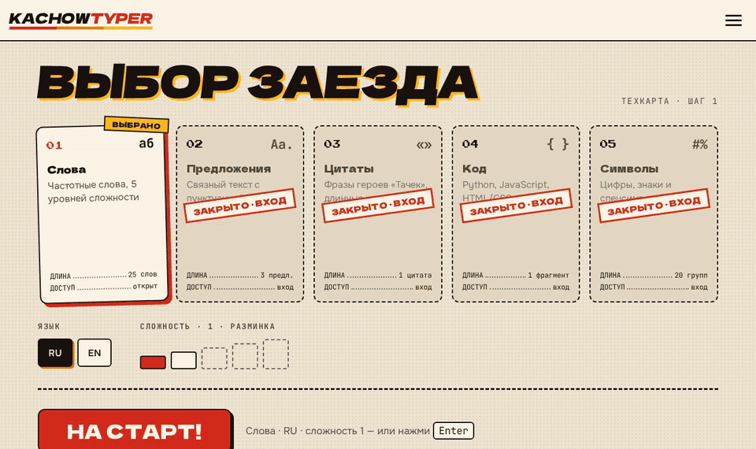
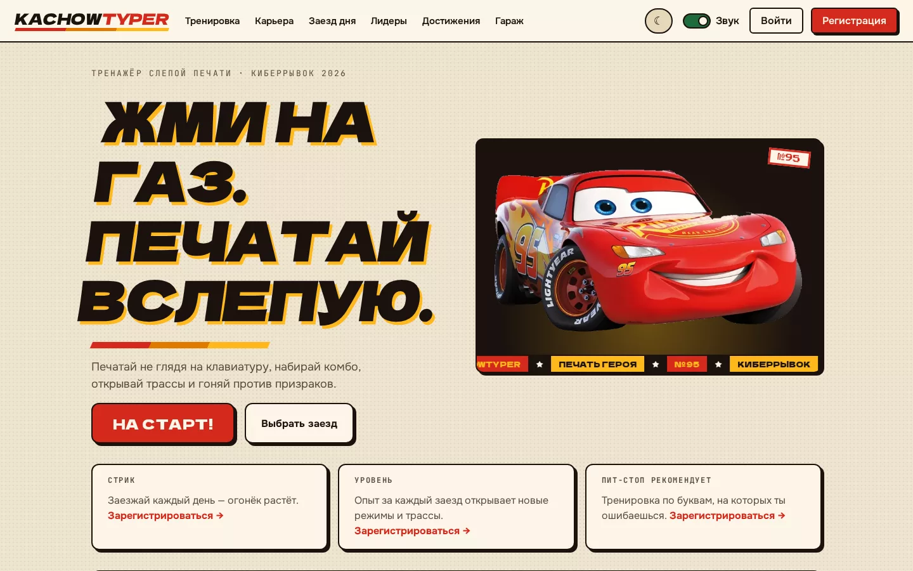
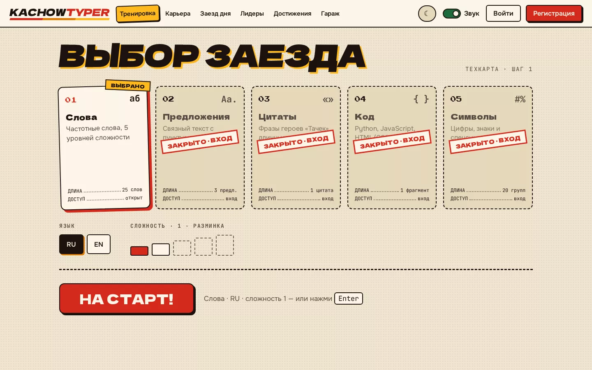
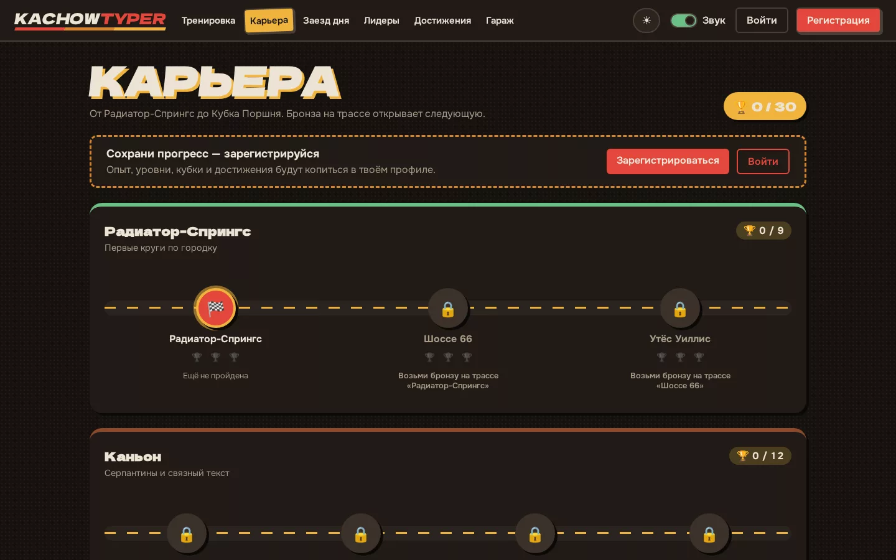
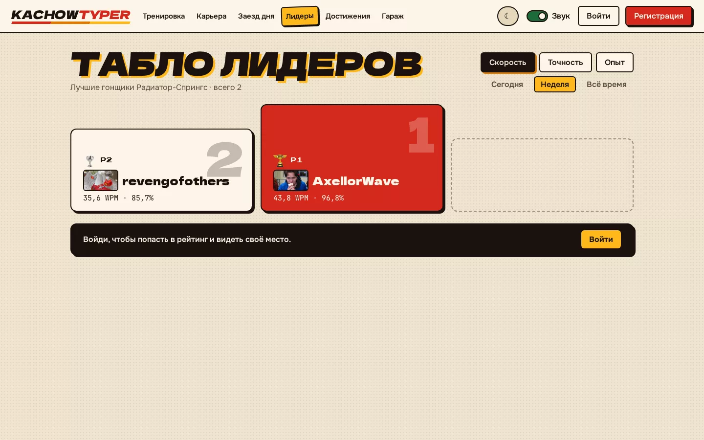
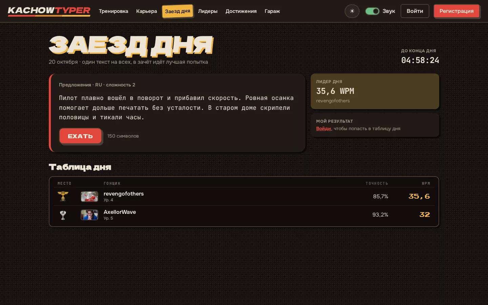
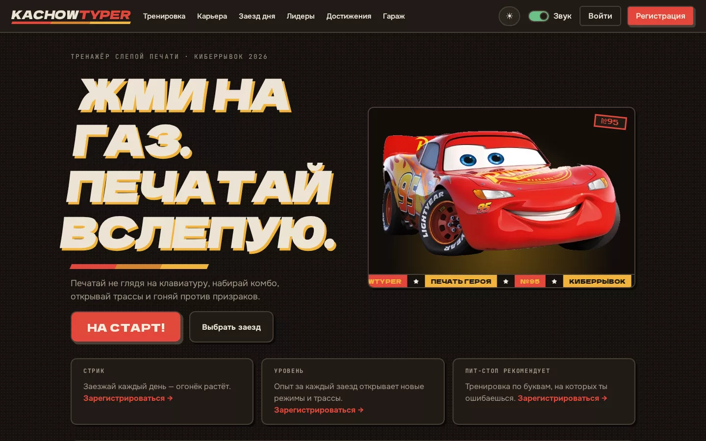
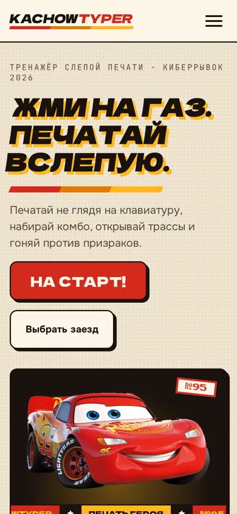
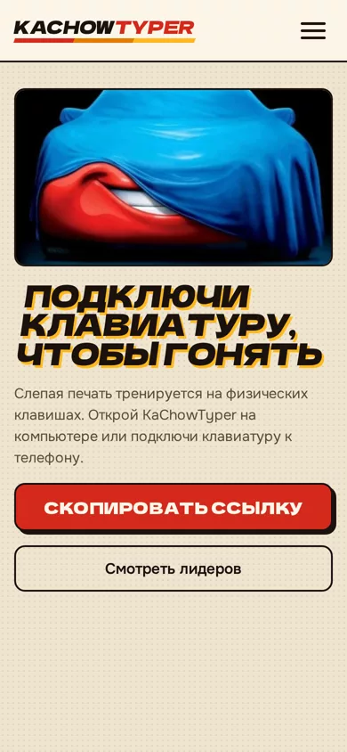
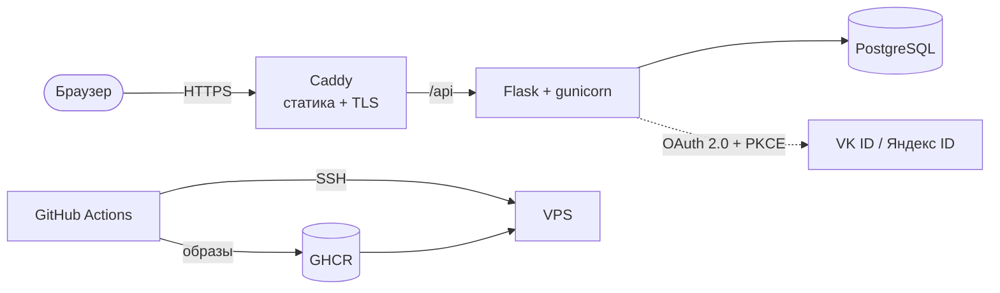

<p align="center">
  <picture>
    <source media="(prefers-color-scheme: dark)" srcset="docs/media/logo-night.svg">
    
  </picture>
</p>

<p align="center">
  <b>Жми на газ. Печатай вслепую.</b><br>
  Тренажёр слепой печати, где каждый верный символ разгоняет Молнию Маквина.
</p>

<p align="center">
  <a href="https://kachowtyper.ru"></a>
  <a href="https://kachowtyper.ru/api/docs"></a>
  <a href="https://github.com/AxellorWave/ka-chow-typer/actions/workflows/docker.yml"></a>
</p>

<p align="center">
  Хакатон «Киберрывок 2026», кейс «Печать героя»
</p>

<p align="center">
  
</p>

## Что внутри

- 🏁 **Заезд вместо упражнения.** Машинка едет по трассе со скоростью твоей печати, ошибка сбрасывает комбо и даёт занос. Светофор, нитро, искры, «Ka-chow!» на ×5.
- 🏆 **Карьера.** 10 трасс от Радиатор-Спрингс до Кубка Поршня, на каждой бронза, серебро и золото за WPM и точность.
- 👻 **Призрак.** Гоняй против своего рекорда или лучшего игрока на этом тексте.
- 📅 **Заезд дня.** Один текст на всех, свой лидерборд и стрик за дни подряд.
- 🔧 **Пит-стоп.** Тренировка, собранная из твоих слабых клавиш и биграмм.
- 🚗 **Гараж.** 5 героев «Тачек», цвета и диски открываются уровнями и ачивками.
- 📈 **Статистика.** Графики WPM и точности, тепловая карта клавиатуры, история заездов.
- 🎖 **17 достижений, уровни и лидерборды** по WPM, точности и XP за день, неделю и всё время.
- ⌨️ **Подсказки.** Экранная клавиатура с зонами пальцев, подсказка рук и детектор раскладки.
- 🔊 **Звук.** Голос отсчёта, музыка заезда и мотор, который гудит выше с ростом скорости.
- 🌗 Светлая и тёмная тема, вход по почте, через VK ID и Яндекс ID.

Пять режимов: слова, предложения, цитаты из «Тачек», символы и код на Python, JavaScript и HTML/CSS. Языки: русский и английский.

В словарях 36 тыс. русских и 28 тыс. английских слов, а ещё больше 13 тыс. предложений: живые фразы и отрывки из классики от Чехова до Диккенса.

## Скриншоты

<table>
  <tr>
    <td></td>
    <td></td>
  </tr>
  <tr>
    <td></td>
    <td></td>
  </tr>
  <tr>
    <td></td>
    <td></td>
  </tr>
</table>

<p align="center">
  
  &nbsp;
  
</p>

<p align="center"><sub>На телефоне без физической клавиатуры заезд не начнётся: слепая печать тренируется на настоящих клавишах.</sub></p>

## Запуск

Нужен только Docker, клонировать репозиторий не обязательно: готовые образы лежат в GHCR.

```bash
mkdir kachowtyper && cd kachowtyper
curl -fsSL https://raw.githubusercontent.com/AxellorWave/ka-chow-typer/main/docker-compose.quickstart.yml -o docker-compose.yml
docker compose up -d
```

Через полминуты откройте http://localhost:8080, Swagger UI будет на http://localhost:8080/api/docs. Тексты, трассы, ачивки и гараж загружаются сами при старте. Остановить и удалить данные: `docker compose down -v` в той же папке.

Этот вариант только для локального знакомства: секреты в нём общие, сайт доступен только с вашей машины.

<details>
<summary>Разработка</summary>

```bash
git clone https://github.com/AxellorWave/ka-chow-typer.git && cd ka-chow-typer
cp .env.example .env && docker compose up --build -d && docker compose exec backend flask seed
```

Фронтенд с hot reload на http://localhost:5173, API на http://localhost:5000, PostgreSQL на `localhost:5432` с логином и паролем `kachow`. Вход через VK ID и Яндекс ID заработает после того, как вы впишете ключи в `.env`.

</details>

<details>
<summary>Продакшен</summary>

Каждый push в `main` собирает образы `backend` и `web` в GHCR и по SSH выкатывает их на сервер. Caddy сам выпускает HTTPS-сертификат для `DOMAIN`.

Первый запуск на сервере:

```bash
git clone https://github.com/AxellorWave/ka-chow-typer.git && cd ka-chow-typer
cp .env.example .env
./scripts/deploy.sh
```

В `.env` обязательно задать `DOMAIN`, `FRONTEND_URL`, `CORS_ORIGINS` и случайные `SECRET_KEY` и `JWT_SECRET_KEY` длиной от 32 символов. С дефолтными секретами бэкенд в проде не стартует. Сгенерировать: `python -c "import secrets; print(secrets.token_urlsafe(48))"`.

Для автодеплоя нужны секреты окружения `production` в настройках репозитория: `DEPLOY_HOST`, `DEPLOY_USER`, `DEPLOY_SSH_KEY`, по желанию `DEPLOY_PORT` и `DEPLOY_PATH`. Откат на конкретный коммит: `IMAGE_TAG=sha-<7 символов> ./scripts/deploy.sh`.

</details>

## Как считаются очки

| Что | Формула |
|---|---|
| Очки за символ | `10 × комбо × турбо` |
| Комбо | ×2 с 20 верных подряд, ×3 с 50, ×5 со 100; ошибка сбрасывает до ×1 |
| Турбо | раз в 20–40 секунд на 10 секунд очки удваиваются |
| WPM | `CPM / 5`, CPM и точность сервер пересчитывает по нажатиям |
| XP за заезд | `⌊очки / 10⌋` |
| Порог уровня | `⌈100 × уровень^1.5⌉` XP: 2-й уровень с 283 XP, 5-й с 1119, 10-й с 3163 |
| Кубки трассы | бронза, серебро и золото за пороги WPM и точности одновременно |

Новые режимы открываются уровнями: предложения и цитаты с 3-го, символы с 5-го, код с 7-го. Сложности 3, 4 и 5 открываются с 8-го, 10-го и 12-го уровня.

Сервер не верит клиенту: метрики заезда пересчитываются по меткам времени каждого нажатия, а очки не могут превысить теоретический максимум.

## Архитектура



| Слой | Технологии |
|---|---|
| Фронтенд | React 19 на JavaScript, Vite, React Router, TanStack Query, Zustand, Chart.js, Framer Motion, Web Audio |
| Бэкенд | Python 3.13, Flask 3, SQLAlchemy, Alembic, marshmallow, Flask-JWT-Extended, gunicorn |
| База | PostgreSQL 16 |
| Инфраструктура | Docker Compose, Caddy, GitHub Actions, GHCR |

Авторизация: короткий access-токен в заголовке и refresh-токен в httpOnly cookie.

```
backend/   API, модели, сервисы геймификации, сиды с текстами, миграции, openapi.yaml
frontend/  React-приложение: движок печати, трасса, эффекты, звук, страницы
design/    макеты, дизайн-система, исходники ассетов и звуков
scripts/   деплой и сборка словарей
```

### Откуда тексты

Слова взяты из частотных словарей [FrequencyWords](https://github.com/hermitdave/FrequencyWords) (CC BY-SA 4.0) и проверены по словарям hunspell. Предложения взяты из [Tatoeba](https://tatoeba.org) (CC BY 2.0 FR), а также из произведений в общественном достоянии с [Project Gutenberg](https://www.gutenberg.org) и [Викитеки](https://ru.wikisource.org). Пересобрать сиды:

```bash
sudo apt install hunspell-ru hunspell-en-us
pip install spylls && python scripts/build_texts.py
```

Скрипт кэширует источники в `.cache/texts`, отбрасывает непечатаемые символы, имена и грубую лексику и раскладывает тексты по сложности по длине и частотности.

## API

Вся документация API в [`backend/openapi.yaml`](backend/openapi.yaml): 28 эндпоинтов с примерами ответов и кодами ошибок. Открыть в Swagger UI: [kachowtyper.ru/api/docs](https://kachowtyper.ru/api/docs), локально http://localhost:8080/api/docs.

## Как мы работали

Задачи вели в [issues и milestones](https://github.com/AxellorWave/ka-chow-typer/milestones) по этапам: MVP по ТЗ → фичи → релиз. Одна задача — одна ветка и один PR со squash-merge, заголовок PR становится сообщением коммита.

---

<sub>Фан-проект для хакатона. Не связан с The Walt Disney Company и Pixar Animation Studios, персонажи «Тачек» принадлежат правообладателям.</sub>
